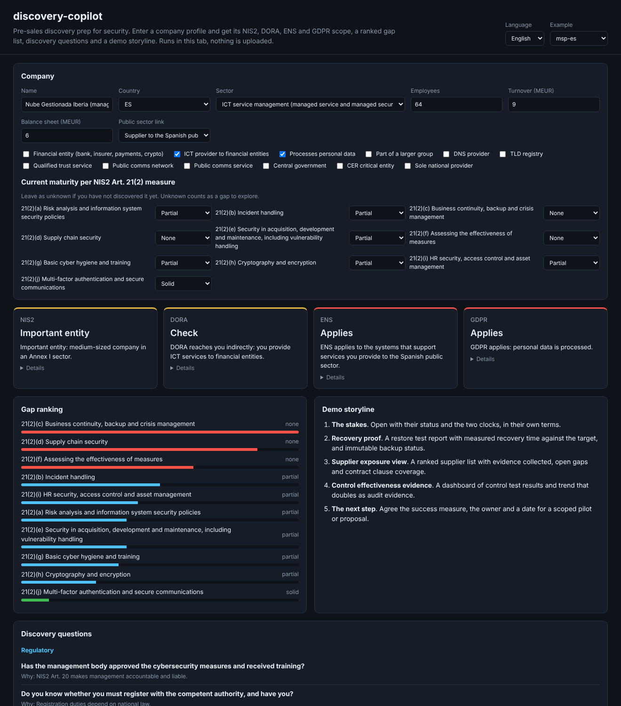

# discovery-copilot

[](https://github.com/jvch0512/discovery-copilot/actions/workflows/ci.yml)

Security pre-sales calls go better when you walk in knowing which rules the customer is under. This takes a company profile (country, sector, size, a few yes/no facts) and prepares the call: NIS2 essential or important classification, whether DORA, ENS and GDPR apply, a ranked gap list against the ten NIS2 Article 21(2) measures, discovery questions in priority order with red flags to listen for, and a demo storyline built from the top gaps. English and Spanish. Runs on your machine, no backend, no upload, no runtime dependencies.



## Run

```bash
npm install
npm test                       # 22 tests
npm start                      # UI on http://127.0.0.1:8787, localhost only
node dist/src/cli.js examples/msp-es.json                 # English brief
node dist/src/cli.js --lang es examples/msp-es.json       # Spanish brief
node dist/src/cli.js --json examples/msp-es.json
```

Exit code 2 on bad input. Profile fields are validated, see `examples/*.json` for the shape. Real outputs are in [docs/sample-brief.md](docs/sample-brief.md) and [docs/sample-brief.es.md](docs/sample-brief.es.md), and CI fails if they drift.

## What it decides

**NIS2 classification** (Directive (EU) 2022/2555, Articles 2 and 3, Annexes I and II). Size follows Recommendation 2003/361/EC. Large companies in an Annex I sector are essential, medium ones important. Annex II sectors give important entities only. Some entities are in scope at any size: DNS providers, TLD registries, qualified trust service providers (essential), public communications providers (essential from medium size, important below), central government and CER critical entities (essential), and sole national providers (flagged for designation, because the Member State decides). Group membership and figures within 15 percent of a threshold raise a warning. Below the cap it says so, and tells you to ask about supply chain pressure from in-scope customers, which is where most of the real conversation is.

**DORA** (Regulation (EU) 2022/2554). Applies to financial entities. ICT providers to financial entities are flagged as reached through contracts and possible critical-provider designation. For financial entities it notes DORA replaces the NIS2 Article 21 and 23 duties.

**ENS** (Real Decreto 311/2022). Spain only: public bodies and private suppliers to the Spanish public sector.

**GDPR.** Article 32 security and the 72 hour Article 33 breach clock, next to the NIS2 clocks.

**Gap ranking.** Each Article 21(2) measure scores by maturity (none, unknown, partial, solid) times a weight that favours the measures that decide ransomware outcomes: incident handling, backups and crisis management, multi-factor authentication, access control and supply chain. Unknown ranks just below none: not knowing is something to discover, not a pass.

**Questions.** Three open questions per measure with a red flag and a vendor-neutral demo beat, plus framework questions that appear only when the framework applies, plus five commercial questions (trigger, budget owner, deadline, incumbent, success measure). The top three gaps get all questions, the rest one validation question each.

Once discovery is done, the numbers and the proposal are the job of [presales-studio](https://github.com/jvch0512/presales-studio).

## Spain and NIS2

As of the last review (November 2026) Spain had not completed transposition. The draft Ley de Coordinación y Gobernanza de la Ciberseguridad was approved by the Council of Ministers as a bill on 14 January 2025 and was still in the legislative process, so Real Decreto-ley 12/2018 stays the binding rule. The tool says this in the output for Spanish profiles and says to check the BOE. For other countries it only says NIS2 is a directive and that national law decides. Rules live in `src/data.ts` and `src/scope.ts` with a review date; update them when the law moves.

## Safety notes

- Strict CSP (`default-src 'none'`, scripts and styles from `self`, no inline code). Profile text reaches the page only through `textContent`.
- The dev server binds to 127.0.0.1 and serves only `public/`, `dist/src` and `examples/`.
- Examples are fictional companies.

## Limits

Classification is a first read from five facts, not a legal opinion. Sector fit (for example which manufacturing types Annex II lists, or what counts as a managed security service) needs a human check, and national transposition can widen or narrow scope. The weights and demo beats are judgement values. **This is pre-sales preparation, not legal advice: confirm scope with counsel and the competent authority.** Fines quoted are the maximums in Article 34.

MIT licensed.
